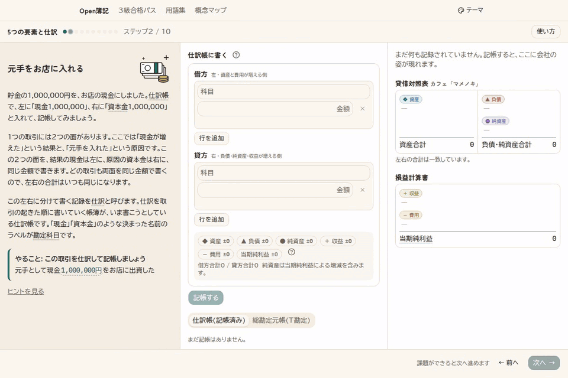

# Open簿記

会計を原理から、手を動かして学ぶオープンソースの学習サービス。

OpenBoki is an open-source, learn-by-doing course for Japanese bookkeeping and accounting: post a journal entry and watch the financial statements change.

[貢献ガイド](CONTRIBUTING.md) · [Discussions](https://github.com/openboki/openboki/discussions) · [ロードマップ](docs/roadmap.md) · [ビジョン](docs/vision.md)



## Open簿記とは

Open簿記(読みは「オープン簿記」、英字表記はOpenBoki)は、簿記と会計を基礎から学ぶWebサービスです。物語と課題、仕訳帳、財務諸表を1画面に置いた「会計IDE」で、仕訳を記帳すると貸借対照表と損益計算書がその場で動きます。プログラミングをコードを書いて実行しながら覚えるのと同じやり方で、会計を学びます。

簿記をこれから始める人、検定の勉強で仕訳を暗記することに疑問を持った人、会計の仕組みを知りたいエンジニアに向けて作っています。目指しているのは「日本の会計教育に、オープンソースの文化を」。教材もコードも公開し、学習者と会計の実務家が一緒に直していける形にします([docs/vision.md](docs/vision.md))。

## 特徴

- 記帳すると財務諸表が動く。仕訳の前に5要素(資産・負債・純資産・収益・費用)の動きを予想し、結果と見比べる課題もあります。
- 不正解を「どの誤解か」まで返す。貸借を逆に書いた、仕入を資産だと思った、といった思い込みを名指しして、正しい仕訳との影響の差を見せます。
- 原理から説明する。どの単元も、その処理がなぜ存在するかから始めます。専門用語は初出で定義し、本文のどこからでも意味を開けます。
- 無料で、登録なしに使える。学習の記録は匿名のまま保存されます。
- 教材もオープン。解説と演習はすべて自作で、`content/`にMarkdownとYAMLで置いてあり、Pull Requestで直せます。

## いま学べること

公開サイト(openboki.org)は準備中で、いまは手元で動かして試せます。

- 簿記3級合格パス: 簿記の仕組み、商品売買、現金・預金、債権・債務、固定資産、貸倒れの17単元。3級の残りの範囲(決算整理、精算表、伝票など)はこれから書きます。
- 会計の歴史パス: 複式簿記の誕生をたどる3単元。
- 用語集と、概念のつながりを図で見る概念マップ。

開発はロードマップのM1(学習ループの検証)の段階です。この先の予定は[docs/roadmap.md](docs/roadmap.md)にあります。

## 手元で動かす

Node.js 24、pnpm、Docker(ローカルのSupabaseが使う)が要ります。

```bash
git clone https://github.com/openboki/openboki.git
cd openboki
make setup       # 依存のインストールとgit hookの有効化
make db-start    # ローカルのSupabaseを起動する(初回はイメージの取得に数分かかる)
make env-local   # Supabaseの接続先を.env.localに書く
make dev         # http://localhost:3000
```

変更をPull Requestにする前に`make check`(lint / 型 / 単体テスト / ビルド / E2E)を通します。教材だけを検査するなら`make content`、コマンドの一覧は`make help`です。

## 貢献する

教材の誤りの報告、分かりにくい説明の指摘、文言の修正、演習や単元の執筆、コードの改善、どれも歓迎します。学んでいて「ここで詰まった」という一言も貢献です。

| したいこと | 入口 |
|---|---|
| 質問する、誤りや分かりにくさを伝える、提案する | [Discussions](https://github.com/openboki/openboki/discussions)に単元のURLとステップ番号を書く |
| 文言や例を直す | GitHubのWeb編集で`content/`のファイルを直してPull Requestを出す(環境構築は不要) |
| 演習・単元を書く、コードを直す | 上の手順で環境を作り、Pull Requestを出す |

検定の過去問、教科書、Web記事の文章は転載できません。コミットにはDCOへの同意(`git commit -s`)が要ります。教材の書き方とレビューの流れは[CONTRIBUTING.md](CONTRIBUTING.md)、行動規範は[CODE_OF_CONDUCT.md](CODE_OF_CONDUCT.md)にあります。

## リポジトリの構成

```
content/    教材(単元・概念・勘定科目・誤解・学習パス)。MarkdownとYAML
src/        Next.jsアプリ(app: ページ、components: UI、lib: 採点・会計計算・進捗保存)
supabase/   ローカルスタックの設定とマイグレーション
e2e/        E2Eテスト(全単元を自動で解く)
scripts/    品質確認と無人ループのスクリプト
docs/       設計文書とADR
```

教材を書くなら[docs/content-model.md](docs/content-model.md)、コードを触るなら[docs/architecture.md](docs/architecture.md)と[docs/ide-design.md](docs/ide-design.md)、見た目は[docs/design-system.md](docs/design-system.md)と[docs/visual-guidelines.md](docs/visual-guidelines.md)から読みます。設計判断の理由は[docs/decisions/](docs/decisions/)のADR、Issueの切り方と統合までの流れは[docs/development-process.md](docs/development-process.md)、不具合を無人で見つけて直す仕組みは[docs/quality-loop.md](docs/quality-loop.md)にあります。

## ライセンスと商標

コードは[Apache License 2.0](LICENSE)、`content/`以下の教材は[CC BY-SA 4.0](content/LICENSE)で公開しています(ADR 0007)。

名称「Open簿記」「オープン簿記」「OpenBoki」とロゴは商標として扱い、どちらのライセンスの対象にも含めません。フォークは自由ですが、同じ名前でサービスを名乗ることはできません。
